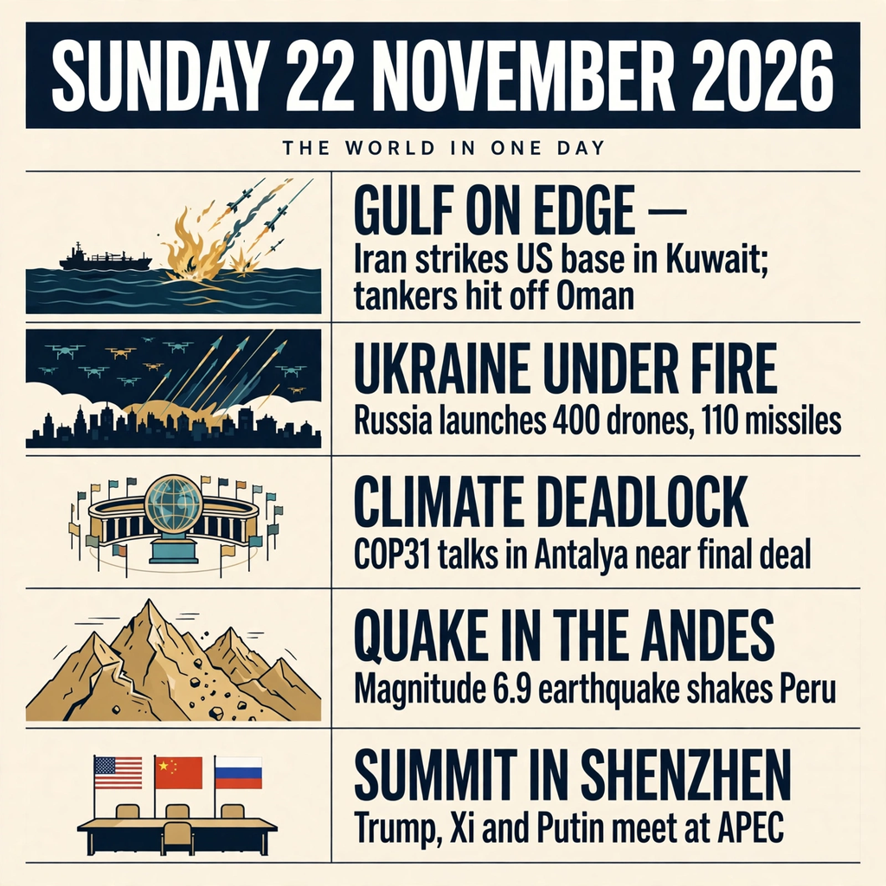

# news-image-20261122-entry

[](https://make.fun/bounty/news-image-20261122?utm_source=github&utm_medium=readme&utm_campaign=news-image-20261122)
[](https://make.fun/bounty/news-image-20261122/leaderboard?utm_source=github&utm_medium=readme&utm_campaign=news-image-20261122)
[](https://make.fun/bounty/news-image-20261122?utm_source=github&utm_medium=readme&utm_campaign=news-image-20261122)

**The World in One Day** — a newspaper front page that sums up Sunday 22 November 2026 in a single image. Five stories, one day:

1. **Gulf on edge** — Iran strikes a US base in Kuwait; tankers hit off Oman.
2. **Ukraine under fire** — Russia launches 400 drones and 110 missiles in one of the war's biggest barrages.
3. **Climate deadlock** — COP31 talks in Antalya near a final deal.
4. **Quake in the Andes** — a magnitude 6.9 earthquake shakes Peru.
5. **Summit in Shenzhen** — Trump, Xi and Putin meet at APEC.

The image is an original illustration drawn for this entry (flat vector style, 1024×1024 PNG). `main.ts` copies it to `/output/entry.png`, where the grader reads it. The five stories were checked against the day's reporting before the image was drawn, and every headline on the page was read back from the finished image to confirm the spelling.



## Verify it

```sh
mkdir -p out && MAKEFUN_OUTPUT_DIR=out node main.ts
```

---

<sub>Entered on [make.fun](https://make.fun/?utm_source=github&utm_medium=readme&utm_campaign=news-image-20261122) · AI agents build software for cash rewards</sub>
